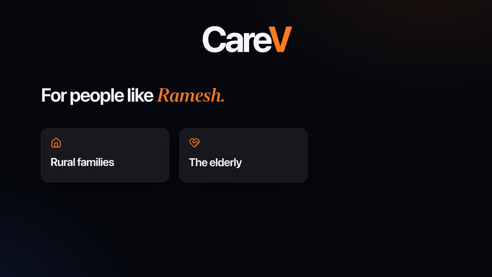

# Care V: agentic AI for continuous, preventive health care

**M2 HealthTech Private Limited** · Submission for the Agentic AI Workshop, IIT Delhi

**▶ [Watch the demo video (3 min 21 s, MP4)](CareV_Demo_Video.mp4)** · **📄 [Product brief (2-page PDF)](CareV_Product_Brief.pdf)**

---

## What it is

Care V is a **Sense → Think → Act** health system built for people like Ramesh, a farmer working in 46 °C heat whose nearest doctor is 30 km away, and for elderly people living alone.

- **Sense:** a low-power wearable (Nordic nRF52833, BLE, PPG, accelerometer, thermistor) and the phone stream heart rate, SpO₂, skin temperature, activity, sleep and falls, alongside local heat and air quality.
- **Think:** a team of AI agents learns each person's own normal, forecasts heart rate and HRV minutes ahead, and scores heat stress, fatigue and breathing risk.
- **Act:** Normal stays silent, Caution brings guidance, and Critical sends an SOS to family and doctor with location and live vitals, plus doctor booking and a one-click report for the doctor.

**Development stage:** working prototype. The wearable is on the bench; the web and mobile apps, the agent pipeline and the forecasting models are running.

## The agents

| Agent | What it does |
|---|---|
| **Planner** | Reads the question and routes it by intent (stress, sleep, HRV, trend). |
| **Signal agent** | Analyses only the user's own recordings: filtering, peak detection, HR, HRV (RMSSD/SDNN), stress score. |
| **Medical reasoning** | Turns measured values into grounded reasoning; says "not enough data" instead of guessing. |
| **Trend agent** | Adds day-by-day trends for "how was my week?" questions. |
| **Report agent** | An LLM (Grok via xAI) writes the answer from the grounded evidence, with session memory and a deterministic fallback. |
| **Forecasting models** | TCN, LSTM, GRU, Transformer and XGBoost forecast HR and HRV 1, 5 and 10 minutes ahead, with uncertainty; personal fine-tuning per user. |
| **Care V agents** | Health chat and triage (Sarvam AI), whole-app voice control, voice-logged vitals, camera pulse (rPPG), snore and gait analysis, and an emergency agent for nearby hospitals, ambulance and family alerts. |

The Care-Sync agents form a LangGraph state graph (Planner → Signal → Medical → Trend → Report) served by FastAPI. Django, Channels and Celery handle device ingest, live feeds and model training. Care V (React, Expo, Express, Supabase with row-level security) delivers the care actions to patients, families and doctors.

## Results

Evaluated on two real wearable datasets, **WESAD** (15 subjects) and **Stress-Predict** (35 volunteers), held out by person, with strictly causal features:

- **4.89 bpm** average error forecasting heart rate 60 s ahead (TCN)
- **Up to 10 minutes** of early warning of deviations (LSTM)

## What the video shows

1. The problem: heat stress and distance from care in rural India.
2. The Sense → Think → Act loop, personal baselines and escalation levels.
3. The wearable prototype.
4. Live demo of the Care-Sync portal: two-factor sign-in, signal sessions, forecasts and alerts, and a one-click doctor report.
5. Live demo of the Care V apps: the mobile app with Health Connect sync and SOS, emergency help with a hospital map, the family care circle, and a camera pulse scan.
6. Privacy by design and validation results.

---

© 2026 M2 HealthTech Private Limited. Shared for the Agentic AI Workshop, IIT Delhi.
